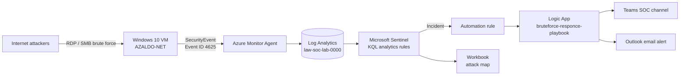

# Azure SOC Lab: Brute-Force Detection and Automated Response

A cloud SOC lab built on Microsoft Sentinel and Azure Logic Apps. An internet-exposed Windows VM generates real brute-force telemetry, KQL analytics rules turn failed logons into incidents mapped to MITRE ATT&CK, and a Logic App playbook notifies analysts through Microsoft Teams and email within seconds of each incident.

| Metric | Value |
|---|---|
| Failed logons captured | ~1.2 million in 24 hours |
| Source locations | 30+ countries |
| Alerts generated | 1,819 in 7 days |
| Incidents created | 33 in 7 days |
| Analytics rules | 3 (MITRE T1110, Credential Access) |

---

## Contents

- [Architecture](#architecture)
- [Environment](#environment)
- [Detection engineering](#detection-engineering)
- [MITRE ATT&CK mapping](#mitre-attck-mapping)
- [Automated response](#automated-response)
- [Attack map and findings](#attack-map-and-findings)
- [Evidence](#evidence)
- [Challenges and fixes](#challenges-and-fixes)
- [Limitations and next steps](#limitations-and-next-steps)

---

## Architecture



**Flow:** failed Windows logons (Event ID 4625) are collected by the Azure Monitor Agent into a Log Analytics workspace. Sentinel analytics rules run on a schedule, group failures by attacker and target, and raise incidents when the threshold is crossed. An automation rule passes each incident to the Logic App, which extracts the attacker IPs and sends the alert to Teams and email.

---

## Environment

All resources are deployed in a single resource group (`SOC-LAB`) in East US 2.

| Resource | Type | Purpose |
|---|---|---|
| `AZALDO-NET` | Virtual machine (Windows 10 Pro) | Honeypot target generating authentication telemetry |
| `AZALDO-NET-nsg` | Network security group | Deliberately allows inbound RDP (3389) and SMB (445) from the internet |
| `AZALDO-NET-ip`, `vnet-eastus2` | Public IP, virtual network | Network exposure for the VM |
| `law-soc-lab-0000` | Log Analytics workspace | Central log store for the `SecurityEvent` table |
| Microsoft Sentinel | SIEM solution on the workspace | Analytics rules, incidents, workbooks |
| `bruteforce-responce-playbook` | Logic App | SOAR playbook for incident notification |
| `la-abuseipdb-ti` | Logic Apps custom connector | AbuseIPDB threat-intelligence lookup (in progress) |

> The VM is intentionally exposed to attract real attack traffic. It holds no production data and should be deallocated or deleted when the lab is not in use.

---

## Detection engineering

Alerting on every Event ID 4625 would generate thousands of alerts per hour. The analytics rule instead summarises failures per attacker IP, target account and host, and only fires above a threshold.

```kql
SecurityEvent
| where EventID == 4625                    // failed logon
| where isnotempty(IpAddress)              // exclude local/system failures
| summarize
    StartTime      = min(TimeGenerated),
    EndTime        = max(TimeGenerated),
    FailedAttempts = count()
    by Account, IpAddress, Computer
| where FailedAttempts > 15                // filter out normal user mistakes
| extend
    AccountCustomEntity = Account,
    IPCustomEntity      = IpAddress,
    HostCustomEntity    = Computer
```

| Design choice | Reason |
|---|---|
| `summarize ... by Account, IpAddress, Computer` | One result per attacker–target pair instead of one per failed logon |
| `FailedAttempts > 15` | Catches automated tools (Hydra, Medusa, botnets) while ignoring occasional typos |
| Entity mapping (IP, account, host) | Lets Sentinel build the investigation graph and pass the attacker IP to the playbook |

**Analytics rules deployed**

| Rule | Severity | Tactic | Technique |
|---|---|---|---|
| Brute force – Multiple failed logons | Medium | Credential Access | T1110 |
| BRUTE FORCE 2 | Medium | Credential Access | T1110 |
| Known malicious IP attempting login | Medium | Credential Access | T1110 |

---

## MITRE ATT&CK mapping

| Tactic | Technique | ID | How the lab addresses it |
|---|---|---|---|
| Credential Access | Brute Force | T1110 | KQL threshold detection and automated alerting |
| Initial Access | Valid Accounts | T1078 | Failed-logon monitoring on targeted accounts (`Administrator` and others) |
| Reconnaissance | Active Scanning | T1595 | Source-IP geolocation in the attack-map workbook |

---

## Automated response

The playbook `bruteforce-responce-playbook` is triggered by a Sentinel automation rule on incident creation.

| Step | Logic App action | Output |
|---|---|---|
| 1 | Microsoft Sentinel incident (trigger) | Incident title, severity, creation time |
| 2 | Entities – Get IPs | Attacker IP addresses parsed from the incident |
| 3 | Post message in a chat or channel | Alert card in the `SOC-LAB` Teams channel with incident title, severity and IPs |
| 4 | Send an email (V2) | "Sentinel Alert: Brute Force" email to the analyst mailbox |

Using the native **Entities – Get IPs** action avoids hand-parsing the nested incident JSON.

The playbook notifies but does not block. Containment remains a manual analyst decision (see [next steps](#limitations-and-next-steps)).

---

## Attack map and findings

A Sentinel workbook geolocates `IpAddress` from `SecurityEvent` to show where attacks originate.

| Source location | Failed logons |
|---|---|
| Glendora, United States | 263,000 |
| Braga, Portugal | 143,000 |
| Prague, Czechia | 88,300 |
| Ranchos, Argentina | 67,700 |
| Springfield, United States | 38,700 |
| Maasen, Netherlands | 34,400 |
| Paulista, Brazil (two sources) | 62,800 |
| Almancil, Portugal | 31,400 |
| Other locations | 459,000 |

**Observations**
- A small number of sources produced most of the volume: the top two locations account for over a third of all attempts, consistent with automated tooling rather than manual attacks.
- Targeted usernames included `Administrator`, `AZALDO` and common first names, typical of dictionary-based credential spraying.
- The data supports geo-blocking or source-IP restrictions in the NSG as a first hardening step.

---

## Evidence

| Area | Screenshot |
|---|---|
| Deployed Azure resources | [Resource manager](microsoft%20sentinal/Resource%20manager.png) |
| Raw `SecurityEvent` ingestion | [Lab logs](microsoft%20sentinal/Lablogs.png) |
| KQL query on Event IDs 4624/4625 | [Logs – KQL](microsoft%20sentinal/logsKQL.png) |
| Local Windows Security log on the VM | [Event Viewer](microsoft%20sentinal/vm.png) |
| Analytics rules | [Detection rules](microsoft%20sentinal/Detection%20rules.png) |
| Alerts (1,819 in 7 days) | [Alerts](microsoft%20sentinal/alerts.png) |
| Incidents (33 in 7 days) | [Incidents](microsoft%20sentinal/Incidents.png) |
| Logic App playbook design | [Playbook](microsoft%20sentinal/playbook%20design.png) |
| Teams alert card | [Teams](microsoft%20sentinal/Microsoft%20teams.png) |
| Email alerts | [Outlook](microsoft%20sentinal/Screenshot%202026-02-27%20193304.png) |
| Attack map workbook | [Attack map](microsoft%20sentinal/Vm%20attack%20map.png) |
| Threat analytics feed | [Threat analytics](microsoft%20sentinal/Threat%20analysis.png) |


---

## Challenges and fixes

| Challenge | Fix |
|---|---|
| Early rule versions fired on single typos and legitimate admin mistakes | Grouped failures per attacker–account–host and raised the threshold to more than 15 attempts |
| Raw incident JSON from Sentinel nests entities deeply, making IP extraction in Logic Apps unreliable | Switched to the native **Entities – Get IPs** Sentinel action |
| Alert volume was too high to review individually (1,800+ alerts per week) | Incident grouping in Sentinel reduced this to 33 incidents for triage |

---

## Limitations and next steps

**Current limitations**
- The response is notification only; no automatic blocking.
- Detection uses a fixed count over the rule's lookback period, with no burst window or per-account baseline, so a fast burst and a slow attack look the same.
- The AbuseIPDB connector is deployed but not yet wired into the playbook.

**Next steps**
- [ ] Enrich each incident with AbuseIPDB and VirusTotal reputation in the playbook.
- [ ] Add a Teams approval step that updates the NSG to deny the attacker IP when the analyst approves.
- [ ] Add a time window (for example `bin(TimeGenerated, 5m)`) to detect bursts separately from slow attacks.
- [ ] Create a honeytoken administrator account that raises a high-severity incident on any logon attempt.
- [ ] Export the analytics rules and playbook as ARM/Bicep templates so the lab can be redeployed from code.
